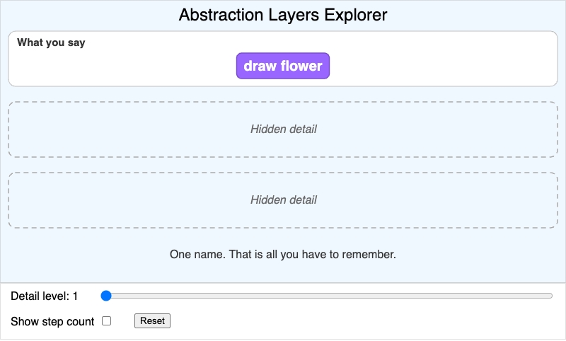
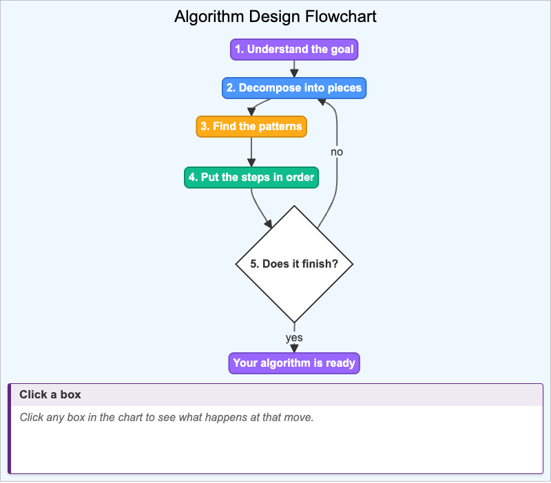
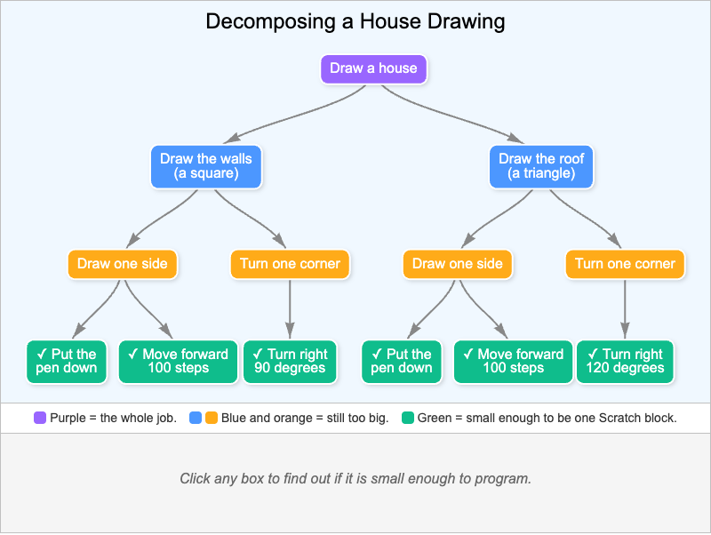
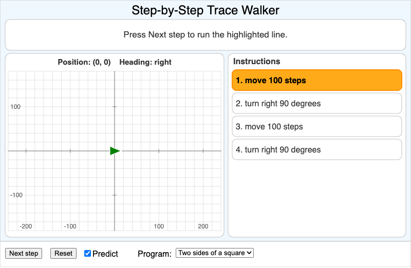
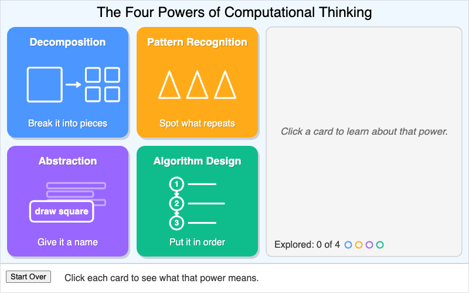

# MicroSims

This book includes **5 interactive MicroSims** — self-contained, browser-based visualizations you can explore directly. Click any thumbnail to open the MicroSim.

<!-- This gallery is generated by generate-sims-index.py — edits here will be overwritten. -->

  <a href="abstraction-layers-explorer/" title="Abstraction Layers Explorer" style="display:block;border:1px solid #e3e7ec;border-radius:8px;overflow:hidden;text-decoration:none;color:inherit;box-shadow:0 1px 3px rgba(0,0,0,0.08);">Abstraction Layers Explorer</a>
  <a href="algorithm-design-flow/" title="Algorithm Design Flowchart" style="display:block;border:1px solid #e3e7ec;border-radius:8px;overflow:hidden;text-decoration:none;color:inherit;box-shadow:0 1px 3px rgba(0,0,0,0.08);">Algorithm Design Flowchart</a>
  <a href="house-decomposition-tree/" title="Decomposing a House Drawing" style="display:block;border:1px solid #e3e7ec;border-radius:8px;overflow:hidden;text-decoration:none;color:inherit;box-shadow:0 1px 3px rgba(0,0,0,0.08);">Decomposing a House Drawing</a>
  <a href="trace-walker/" title="Step-by-Step Trace Walker" style="display:block;border:1px solid #e3e7ec;border-radius:8px;overflow:hidden;text-decoration:none;color:inherit;box-shadow:0 1px 3px rgba(0,0,0,0.08);">Step-by-Step Trace Walker</a>
  <a href="four-powers-explorer/" title="The Four Powers of Computational Thinking" style="display:block;border:1px solid #e3e7ec;border-radius:8px;overflow:hidden;text-decoration:none;color:inherit;box-shadow:0 1px 3px rgba(0,0,0,0.08);">The Four Powers of Computational Thinking</a>

